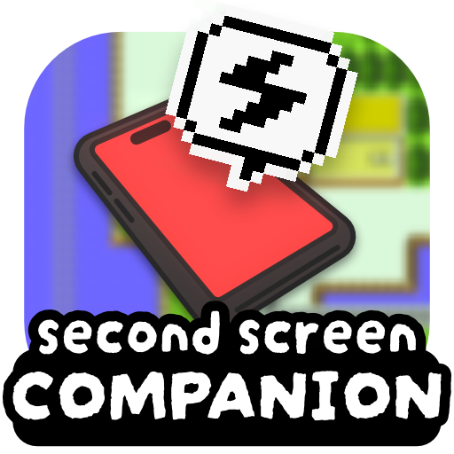

**A live dashboard for [G1R Deluxe](https://github.com/bryanthaboi/gen1recomp).**

See your game on your phone, tablet or TV while you play. Your team, your
bag, the map, wild Pokémon nearby and every battle, live, in any web
browser. There's no app to install.

Works with **Red, Blue and Yellow**, **Gold, Silver and Crystal**, and
**Ruby, Sapphire, FireRed, LeafGreen and Emerald**.

## What it does

- **Your team at a glance:** every Pokémon with its HP, status, level,
  held item, stats and moves. It updates as you play, even mid-battle.
  Eggs show how many steps they still need to hatch (Gen 2 and 3, faster
  with Flame Body or Magma Armor in Ruby, Sapphire and Emerald).
- **Battle helper:** the foe's HP and the moves it has used so far, the
  trainer's team, stat changes (like ATK×0.66 after a Growl), weather, and
  effects such as Leech Seed, Reflect or Perish Song with the turns left.
- **DexNav:** which wild Pokémon live where you're standing, at what level
  and how often, with the ones you've caught marked. Roaming legendaries
  show up when they're on your route.
- **Maps:** the area you're in with its exits and items, and the town map
  with where you are.
- **Pokédex:** every entry with pictures, descriptions, evolutions, moves,
  where to find each Pokémon, its cry, and its footprint (Gen 2 and 3).
- **Your bag and PC:** see everything, and sort or rearrange it from your
  phone. The game shows the new order too.
- **Use items from your phone:** Potions, status cures, Rare Candy,
  evolution stones, TMs, Repels, the bike and fishing rods. The effect
  plays in the game as usual. In Gold, Silver and Crystal you can also give
  a Pokémon an item to hold.
- **Quick actions:** use Cut, Surf, Fly and other field moves with one tap.
- **Day-Care and Safari Zone:** how many levels your Pokémon gained at the
  Day-Care and what picking them up costs, and your Safari Balls and steps
  left.
- **Shiny hunting helpers:** a reset counter, shiny egg odds, and your
  active shiny chain (with supporting mods, see below).
- **Extras per game:** in Gold, Silver and Crystal, the Pokégear: make and
  answer phone calls and tune the radio from your phone. In Ruby, Sapphire
  and Emerald, follow contests live, see your berry trees, and which
  trainers want a rematch (Match Call in Emerald, Trainer's Eyes in Ruby and
  Sapphire).
- **TV dashboard:** a big overview to leave running on a second screen
  (see below).

## Getting started

1. Turn the mod on in the launcher and start the game.
2. On Windows, a firewall message may pop up the first time. Choose
   **Allow** for **private networks** (your home network).
3. In the game, open **OPTION > PHONE** (in Ruby, Sapphire, FireRed,
   LeafGreen and Emerald: **START > PHONE**) and scan the QR code with
   your phone's camera. Or type the address shown in the corner of the game
   screen into your browser, for example `http://192.168.2.82:8080`.
4. Your phone or TV needs to be on the **same Wi-Fi** as your PC.

That's it. Keep the page open while you play. Bookmark it for next time;
the address normally stays the same.

### Playing on Android or a handheld

The companion should also work when the game runs on an Android phone or
some other handhelds:

- **Wi-Fi must be on** on the device running the game. Some handhelds turn
  it off to save battery.
- **No Wi-Fi around?** Turn on your Android phone's hotspot and connect the
  other device to it.
- **Keep the game awake.** When the screen turns off or the game goes to the
  background, the page pauses until you're back.
- **One viewer is best** on a handheld. Every open page makes the game do a
  little extra work, and small devices have less power to spare.

## Mod options

Find these in the game's options under the mod.

| Option | What it does |
|---|---|
| PHONE SERVER | Turns the companion on or off. |
| PORT | Change it only if the page won't start because another program already uses this number. |
| SHOW URL | When to show the address on the game screen. |
| SECURE MODE | Only your own devices can change things. Each one needs the PIN or the QR code from the PHONE screen once. Off at first. |
| SPOILERS | Show what you haven't discovered yet: trainers' teams, unseen Pokémon, hidden items. |
| SHOW HIDDEN VALUES | Show behind-the-scenes numbers: IVs or DVs, EVs, catch and escape chances, and more. |
| PC TRANSFERS | Move Pokémon and items between your party, bag and PC from your phone. |
| VIBRATION | Your phone buzzes with cries and incoming calls (Android phones; iPhones can't do this from a web page). |
| HANDS-OFF MODE | Turns the page into the TV dashboard. |
| PLAYER ON MAP | Shows where you are on the map in LOCATION (and on the TV dashboard) as a square. |
| SHINY HUNT | Adds a reset counter to the LIVE tab for shiny hunting. Every time you load your save (CONTINUE after a soft reset, or F2), it counts one more. Fix it with - and +, or set it back to 0. It also shows how likely you were to find a shiny by now (Gen 2 and 3: 1 in 8192 per try). The Day-Care shows how likely each egg is to hatch shiny. With SPOILERS on, you can also see whether your eggs, and the roaming legendary in Ruby, Sapphire and Emerald, will be shiny. |
| SKIN | The page's look: Game Boy, Pokédex Red, FireRed, Emerald, Dark or Modern. |

## TV dashboard (HANDS-OFF MODE)

Made for a TV or second monitor that nobody touches. Everything is on one
screen: your team, the map, the DexNav, and big battle views with the
trainer's team on the side. Pop-ups tell you when you catch a Pokémon, level
up, get an item or earn a badge.

In FireRed and LeafGreen with the FireRed or Emerald skin, caves and other
special places show the game's own artwork in the background.

You can also turn on the dashboard for just one device, so your phone keeps
the normal page. Add `?handsoff=1` to the end of the address on that
device, for example `http://192.168.2.82:8080/?handsoff=1`. For bigger or
smaller text, add `?size=large` or `?size=small` instead. The device
remembers this.

For TVs left on for hours, the screen slowly shifts and dims when nothing
happens, to prevent burn-in.

## Good to know

- **Save in the game to keep changes.** Things you change from your phone
  work just like the game's own menus. They're kept once you save in the
  game.
- **Your PC stays safe.** The page can only show and change your game,
  nothing else on your computer. It can only be reached from your own
  network, not from the internet.
- **Sharing a network?** Anyone on the same Wi-Fi could open the page. Turn
  on **SECURE MODE** if you play on a network with roommates or guests, or
  turn **PHONE SERVER** off on public Wi-Fi.
- **Nothing extra to install.** The few pictures the mod makes for itself
  are built automatically from the game you already imported, and rebuilt
  on their own if you import it again. In Gold, Silver and Crystal, the
  Kanto badges appear once you've played Red, Blue or Yellow with the mod
  on.

## Works with other mods

New Pokémon, items, maps and translations from other mods show up on the
page too. Some mods get extra support:

- **Kanto Reforged:** you also see abilities, gender, held items, its bag
  pockets, both Day-Care Pokémon and the egg, and its roaming legendaries.
  You can give and use its berries from your phone.
- **1025dex:** the DexNav lists the Pokémon 1025dex brings to each area
  for the generations you picked. It doesn't share its fishing and Rock
  Smash Pokémon, so the DexNav leaves those out wherever 1025dex changes
  the wild Pokémon.
- **Untamed Tohjo:** with SHINY HUNT on, the DexNav shows your shiny chain
  in Red, Blue, Yellow, Gold, Silver and Crystal: a chain icon and the
  chain's length next to the Pokémon you're chaining, and a line at the top
  with your current shiny odds for it (about 1 in 82 at a chain of 100).
- **Untamed Advanced:** the same for Ruby, Sapphire, FireRed, LeafGreen
  and Emerald (up to about 1 in 16). Its chain isn't saved, so it starts
  over after a reset.
- **Modern Spawns:** in Ruby, Sapphire, FireRed, LeafGreen and Emerald the
  DexNav lists the Pokémon Modern Spawns picks. Together with **Wilds of
  Hoenn** (the mod that makes its chain's shinies) and SHINY HUNT on, the
  DexNav also shows your shiny chain and its odds.
- **Wilds of Kanto Revival:** with SHINY HUNT on, the reset counter shows
  the wild shiny odds you picked in its SHINY RATE option.

## Something not working?

- **The page doesn't open:** make sure your phone is on the same Wi-Fi as
  the PC, not on mobile data or a guest network. Check that Windows allows
  the game: open **Windows Security**, then **Firewall & network
  protection**, then **Allow an app through firewall**.
- **The address doesn't work and you use a VPN:** turn the VPN off, or ask
  someone to help you find your PC's Wi-Fi address.
- **"Could not listen on port":** pick another **PORT** in the mod options.
- **The page says the game can't be reached:** the game was closed or the
  PC went to sleep. It reconnects by itself once the game is back.
- **"Too many wrong PINs":** wait a little, or scan the QR code instead.

---

For all the details of every feature and how the mod works inside, see
[TECHNICAL.md](TECHNICAL.md).
